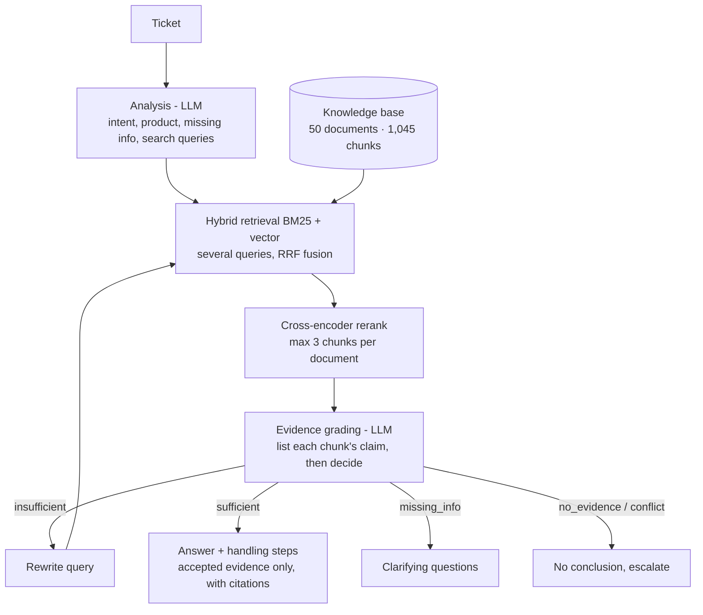

# Corrective RAG for Customer-Support Tickets

An AI assistant for customer-support agents at a (fictional) Vietnamese electronics retailer. For each ticket it retrieves evidence from internal documents, proposes handling steps and drafts a reply with citations. It does not answer without grounds:
- it **rewrites the query and searches again** when the evidence is not enough;
- it **asks the customer** when the ticket lacks required information;
- it **refuses to conclude and escalates** when the documents have nothing on the topic or contradict each other.

Three architectures (**Vector RAG**, **Hybrid RAG** and **Corrective RAG**) are compared on 150 labelled Vietnamese tickets.

## 1. Architecture



| | Vector RAG | Hybrid RAG | **Corrective RAG** |
|---|---|---|---|
| Retrieval | vector (`text-embedding-3-small`) | BM25 + vector, RRF | BM25 + vector, **ticket + LLM-written queries**, RRF |
| Reranker | none | `bge-reranker-v2-m3` | `bge-reranker-v2-m3` on the accumulated pool |
| Evidence control | none | none | LLM grading: `sufficient / insufficient / missing_info / no_evidence / conflict` |
| Correction | none | none | query rewriting, up to 3 rounds |
| Generation input | top 6 chunks | top 6 chunks | **accepted chunks only**, citations required |
| LLM calls / ticket | 1 | 1 | 2-5 |

All three share the same answer prompt, and the baselines may also choose "clarify" or "escalate", so differences come only from retrieval and the correction loop.

Two rules in code back up the grader:
- a conflict counts only if the conflicting chunks come from **two different documents**;
- if the analysis found nothing missing but the grader still wants to ask the customer, the system searches one more round first.

**Stack:** OpenAI `gpt-4o-mini` (generation) with Structured Outputs, `gpt-4.1-mini` (judge), `text-embedding-3-small`, BAAI `bge-reranker-v2-m3`, own BM25 for Vietnamese (syllable unigrams + bigrams + accent-stripped tokens), FastAPI, Streamlit, Docker Compose.

## 2. Data

**Knowledge base** (`data/kb/`): 50 Markdown documents with front matter.

| Group | Docs | Examples |
|---|---|---|
| Policies, procedures, FAQ | 20 | warranty, returns, refunds, delivery & installation, instalments, membership, trade-in, complaints |
| Troubleshooting guides | 5 | error codes for washers, air conditioners, fridges, TVs, phones/laptops |
| Product catalogs | 25 | 225 products: price, specs, warranty (generated by `scripts/build_catalog.py`) |

Planted hard cases:
- 1 **expired** policy (warranty 2023) with different numbers from the 2025 version;
- 8 **conflicts** between active documents (promotion rules vs return policy, product page vs brand warranty, old FAQ vs delivery policy, ...).

Documents are split by `##` section into chunks of about 300 characters, with a "document > section" header prepended, giving **1,045 chunks**.

**Evaluation set** (`data/eval/tickets.jsonl`, built by `scripts/build_tickets.py`): 150 Vietnamese tickets, some typed without diacritics.

| Type | Tickets | Expected action | Labels |
|---|---|---|---|
| Normal | 80 | answer with citations | gold sections, key facts, reference answer |
| Missing information | 25 | ask the customer | missing slots |
| No evidence | 25 | escalate | - |
| Conflict | 20 | escalate | the two conflicting sections |

## 3. Metrics

| Group | Metrics |
|---|---|
| Retrieval | Recall@5/10, MRR, nDCG@10, Context Precision (relevance at section level) |
| Answer | Decision Accuracy, Answer Accuracy (LLM judge vs reference), Key-fact Recall, Faithfulness, Citation Accuracy |
| Safety | Hallucination Rate, Unsafe Answer Rate, Abstention, Escalation / Clarify precision and recall |
| Correction | Rewrite Rate, Query Rewrite Success Rate, average rounds |
| Performance | latency (mean, p95), LLM calls, tokens and USD cost per ticket |

The judge (`gpt-4.1-mini`) is stronger than the generator (`gpt-4o-mini`) to reduce self-grading bias. Definitions are in `src/rag_cskh/eval/metrics.py`.

## 4. Results (150 tickets)

| Metric | Vector RAG | Hybrid RAG | **Corrective RAG** |
|---|---|---|---|
| Recall@5 / MRR | 0.765 / 0.734 | 0.865 / 0.862 | **0.885 / 0.871** |
| Context Precision | 0.220 | 0.238 | **0.704** |
| **Decision Accuracy** | 0.553 | 0.607 | **0.807** |
| Answer Accuracy | 0.787 | **0.825** | 0.812 |
| Faithfulness | 0.921 | 0.893 | **0.933** |
| Hallucination Rate ↓ | 0.337 | 0.375 | **0.167** |
| Unsafe Answer Rate ↓ | 0.429 | 0.429 | **0.114** |
| Escalation Recall | 0.044 | 0.022 | **0.733** |
| Clarify Precision / Recall | 0.308 / 0.640 | 0.356 / 0.640 | **0.581 / 0.720** |
| Query Rewrite Success | - | - | 0.812 (10.7% of tickets rewritten) |
| Latency mean / p95 | **2.7 s / 3.6 s** | 8.7 s / 9.4 s | 21.3 s / 52.7 s |
| LLM calls / cost per ticket | **1 / $0.0003** | 1 / $0.0003 | 2.6 / $0.0009 |

Decision accuracy by ticket type:

| Type | Vector | Hybrid | **Corrective** |
|---|---|---|---|
| Normal (80) | 0.81 | **0.93** | 0.88 |
| Missing information (25) | 0.64 | 0.64 | **0.72** |
| No evidence (25) | 0.08 | 0.00 | **0.68** |
| Conflict (20) | 0.00 | 0.05 | **0.80** |

**Findings**
- The baselines almost always answer, even with no grounds or conflicting documents: they escalate less than 5% of the cases that need it. Corrective RAG escalates 73% of them and cuts the hallucination rate from 37.5% to 16.7%.
- Grading also filters the context: Context Precision rises from 0.24 to 0.70.
- The price is extra caution on normal tickets (0.88 vs 0.93 for Hybrid), 2.5x the latency and 3x the tokens. Cost stays below $0.001 per ticket.
- Latency was measured on a laptop without a GPU. LLM time is only 6.4 s per ticket on average; most of the rest is the cross-encoder running on CPU.

**Tuning protocol.** The Corrective RAG prompts and the two code rules were adjusted after error analysis on 20 tickets (5 per type). On the other **130 tickets, never used for tuning**, decision accuracy is Vector 0.59 / Hybrid 0.64 / **Corrective 0.82**, in line with the full-set result.

**Limitations**
- False conflicts between a general rule and its exception (6 normal tickets turned into clarifications).
- Out-of-scope requests sometimes get a clarifying question instead of an escalation (7 tickets).
- A conflict is missed when only one of the two sources is retrieved (4 tickets).
- Synthetic data: documents and tickets were written for this project, so absolute numbers do not transfer to real support data.

## 5. Setup and usage

Python 3.10+ and an OpenAI API key.

```bash
python -m venv .venv && .venv\Scripts\activate        # Linux/macOS: source .venv/bin/activate
pip install -r requirements.txt
pip install -e .
copy .env.example .env                                # then set OPENAI_API_KEY (Linux/macOS: cp)

python -m rag_cskh.cli index                          # embed 1,045 chunks -> data/index
python -m rag_cskh.cli ask "Tủ lạnh Kiwa mua 3 tháng bị hỏng, bảo hành mất bao lâu?"
python -m rag_cskh.cli retrieval                      # retrieval only: vector / BM25 / hybrid / hybrid+rerank
python -m rag_cskh.cli eval --limit 20                # quick run, 5 tickets per type
python -m rag_cskh.cli eval                           # 150 tickets x 3 architectures + judge + report
```

The report is written to `reports/runs/`: `summary.md`, `comparison.png`, `per_ticket.csv`. All LLM and embedding calls are cached on disk and results are appended per ticket, so a run can be resumed and re-running costs nothing. A full run costs well under $1.

API and UI:

```bash
uvicorn api.main:app --port 8000                      # docs at http://localhost:8000/docs
streamlit run app/streamlit_app.py                    # http://localhost:8501
```

Or with Docker:

```bash
docker compose run --rm index
docker compose up -d --build                          # api :8000, ui :8501
```

Set `RERANKER=llm` or `RERANKER=none` to skip installing PyTorch.

## 6. Project structure

```
data/kb/                  50 knowledge-base documents (Vietnamese)
data/eval/tickets.jsonl   150 labelled tickets (Vietnamese)
scripts/                  build_catalog.py, build_tickets.py (data generators)
src/rag_cskh/
  ingest.py               parsing and chunking
  text.py                 Vietnamese tokenisation for BM25
  embeddings.py           OpenAI embeddings (+ offline hash embedder for tests)
  retrieval.py            BM25, vector, hybrid RRF, multi-query search
  rerank.py               bge cross-encoder | LLM | none
  llm.py                  OpenAI Structured Outputs, cache, rate limit, token and cost tracking (+ fake LLM for tests)
  prompts.py              analysis, grading, answer and judge prompts (Vietnamese)
  pipelines/              vector_rag, hybrid_rag, corrective_rag
  eval/                   metrics.py, runner.py (run, judge, report)
  cli.py                  index | ask | retrieval | eval
api/main.py               FastAPI
app/streamlit_app.py      agent UI
tests/                    24 offline tests (fake LLM, hash embeddings): pytest -q
```

The prompts and customer-facing replies are in Vietnamese because the tickets, documents and replies are Vietnamese.
